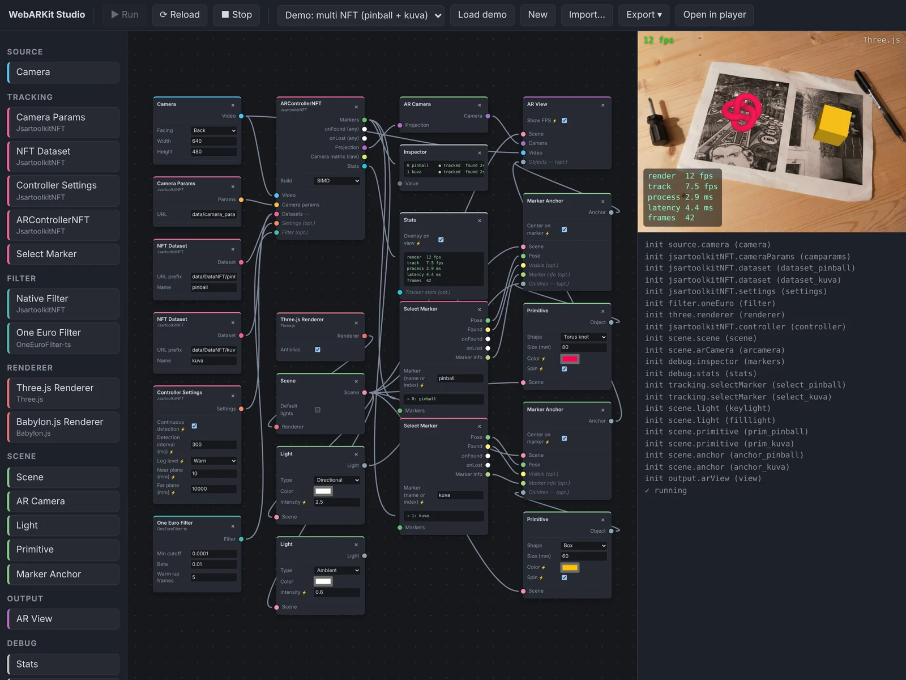

# WebARKit Studio

[](https://github.com/webarkit/webarkit-studio/actions/workflows/ci.yml)
[](https://www.typescriptlang.org/)
[](LICENSE)

<p align="center">
  
</p>

A node-based authoring tool for WebAR experiences. Users wire nodes
(camera → tracker → anchor → view) in a [Rete.js](https://retejs.org) editor; the
result is a plain JSON graph that a lightweight **player** executes with
[JsartoolkitNFT](https://github.com/webarkit/jsartoolkitNFT) and a 3D engine of
choice (Three.js or Babylon.js). The graph can be exported as a standalone app.

> **Status: prototype.** The architecture is being validated: the graph format
> may still change between versions (older graphs are rejected, see
> [Known issues](#known-issues--notes)). Nothing is published to npm.

## Quick start

```bash
npm install
npm run assets      # camera_para.dat, pinball + kuva NFT datasets, test photo
npm run dev         # studio at http://localhost:5173/, player at /player.html
```

Pick a demo (Three.js, Babylon.js, or multi NFT with pinball + kuva), click
**▶ Run** and point the camera at the printed markers. **⟳ Reload** restarts the preview (Stop + Run),
applying every param change; params marked ⚡ apply live without it.

## Multi NFT

ARControllerNFT tracks every NFT Dataset connected to its `Datasets` input
(`loadNFTMarkers`). Its `markers` output is the tracking result of all of them;
a **Select Marker** node picks one, by the dataset's name or by index, and
gives its `pose`, `found`, `onFound`, `onLost` and `markerInfo` to an Anchor.
Pose filters and found / lost state are kept per marker. Select Marker reads a
tracker-agnostic `trackingResult`, so a future `webarkit.nftTracker` will plug
into the same nodes.

## Tests and benchmarks

```bash
npm test             # unit + integration (Vitest)
npm run test:e2e     # end-to-end (Playwright, Chromium); once: npx playwright install chromium
npm run bench        # benchmarks (tinybench); npm run bench -- runtime | tracker
npm run test:all     # typecheck + unit + integration + e2e
```

| Level | What | Where |
|---|---|---|
| Unit | graph validation and topological order, socket types, catalog consistency, runtime scheduler (order, live params, init failures, stop during init) with fake nodes, the mapping onto the tracker facade (filter, settings), the letterbox geometry, Select Marker, Inspector formatting, the trace format, trace diff and Trace Recorder buffering, export file selection and asset paths | `tests/unit` |
| Integration | the tracker session (`NftSession` on `createNFTTracker`, the code the worker runs) against the **Node build** of JsartoolkitNFT on a photo holding both markers: marker sizes, two independent poses, found / lost once per marker, `lostTimeout` and AR2 settings, per-marker filtering, lens and projection, odd video sizes, per-dataset load errors; a **golden run** recorded with the former ARControllerNFT code (found and transitions exact; poses within the recorded range plus a margin, near the recorded mean, and near the recorded frame); **traces**: two recordings identical, a filter change reported, replay, live settings changes, the golden run's found / lost timing kept by the facade | `tests/integration` |
| End-to-end | the studio in Chromium with a fake camera: three demos tracking, onFound after loss, multi NFT, live settings, Reload, init error on the failing node, incompatible wires rejected, a trace downloaded by the Trace Recorder; **exported apps** unzipped and run from a plain static server | `tests/e2e` |

The fake camera is a Y4M video generated in pure JS from the test photo
(`tests/e2e/fake-camera.ts`): the markers are visible 4 s, then hidden 2 s, in
a loop. It must be downscaled with a bicubic filter: a box filter softens the
fine detail enough for KPM to miss the kuva marker.

Benchmarks (Node 22, CI-class container; compare runs, not absolutes):

| `runtime.tick()`, no-op nodes | before | after (inputs resolved once) |
|---|---|---|
| 20 nodes / 19 edges | 8.7 µs | 1.3 µs |
| 80 nodes / 79 edges | 79.7 µs | 4.6 µs |
| 320 nodes / 319 edges | 789 µs | 18.8 µs |

| `NftSession.process()` (tracker facade), 320×240, Node build | mean |
|---|---|
| 1 marker, tracked (AR2) | 1.2 ms |
| 2 markers, tracked (AR2) | 2.3 ms |
| 2 datasets, nothing visible (KPM every frame) | 3.4 ms |

The tracker table was measured on a Windows desktop, not on the container.

### Tracking traces

A trace records what the tracker did, frame by frame, as JSON Lines: a header
(format version, jsartoolkit-nft version, frame size, settings, filter, targets,
where the frames came from), then one record per frame in the shape of the
facade's `FrameResult` (per-target found, pose, error; found / lost transitions;
time and process() duration), plus a record for each live settings change. The
format is defined in `src/runtime/trackers/trace.ts`.

```bash
npm run trace:record -- --out a.jsonl                     # Node: the golden run's frames, deterministic
npm run trace:record -- --out b.jsonl --filter oneEuro    # same frames, another filter (none | native | oneEuro)
npm run trace:record -- --out c.jsonl --replay a.jsonl    # replay a trace's frames and settings with this build
npm run trace:record -- --out g.jsonl --golden            # the golden run (ArtkSession, jsartoolkit-nft 1.14.0)
npm run trace:diff -- a.jsonl b.jsonl                     # pose deltas, found / lost timing, jitter; exit 1 above thresholds
```

In Node the frames are the golden run's (the test photo, then blank frames,
then the photo again, 33 ms apart, `Date.now` pinned), so two recordings of the
same build are identical and `trace:diff` reports *no difference*. In the
browser, wire a **Trace Recorder** (`debug.trace`) to the controller's `trace`
output and turn *Recording* on: the trace downloads when it is turned off, when
*Max frames* is reached or when the preview stops. Camera traces cannot be
replayed, and two of them only compare frame by frame if they have the same
frames; their jitter and timing are still useful.

`trace:diff` thresholds (`--translation-mm 1 --rotation-deg 0.5 --transition-ms 0
--found-frames 0 --jitter-mm 0.5 --jitter-deg 0.25` by default) and `--json` are
documented in `scripts/trace-diff.mjs`.

On devices, connect a **Stats** node to the controller's `stats` output and
enable *Overlay on view*: the exported app then shows render fps, tracking
fps, process() time and latency on the AR view.

CI (`.github/workflows/ci.yml`): typecheck, unit + integration, build, e2e on
every push / PR; benchmarks on pushes to `main`, in the job summary.

## Export

**Export ▾** in the toolbar:

| Format | Content |
|---|---|
| Graph (.json) | the node graph only; re-import it in the studio |
| Standalone app (.zip) | player + graph + assets, runs on any static web server |
| jsartoolkitNFT source code (.zip) | planned: readable code generated from the graph |

The standalone app is the prebuilt player (`npm run build:player`, run
automatically by `dev` and `build`) plus `graph.json` and the files its nodes
reference: params marked `asset` in the catalog (camera parameters, NFT
datasets). Only the chunks the graph uses are included: a Three.js graph
leaves out Babylon.js, a SIMD controller leaves out the standard build
(manifest written by `vite.player.config.ts`). Asset URLs inside the studio
keep their path; others are copied under `data/_ext/` and the graph is
rewritten.

```
pinball-nft-three-js/
  index.html  graph.json  README.txt
  assets/     player, three-adapter, jsartoolkit-nft worker, ARToolkitNFT_simd
  data/       camera_para.dat, DataNFT/pinball.{iset,fset,fset3}
```

Serve it with `npx serve .` or `python3 -m http.server`. The host must answer
404 for missing files (see Known issues).
Camera access requires a secure context: `localhost` works; on a phone use
HTTPS or `adb reverse tcp:5173 tcp:5173`.

## Architecture

```
            ┌──────────────── GraphDocument (JSON) ────────────────┐
            │  nodes: [{id, type, params, position}]               │
            │  edges: [{from:{node,port}, to:{node,port}}]          │
            └───────────────▲───────────────────────┬──────────────┘
          load / toDocument │                       │ validateGraph + topologicalOrder
┌───────────────────────────┴─────┐   ┌─────────────▼──────────────────────────┐
│ Editor (Rete.js + lit-html)     │   │ Runtime / player (no Rete)             │
│ - StudioNode = view of catalog  │   │ - NODE_REGISTRY: type → factory        │
│ - typed sockets, validation     │   │ - init() once, update() every frame    │
└───────────────┬─────────────────┘   └─────────────┬──────────────────────────┘
                └──────── Node catalog (ports + params, no heavy deps) ┘
```

Key decisions:

1. **The JSON graph is the source of truth.** The editor is a view over it, the
   player only reads it. The player bundle contains no Rete code.
2. **Catalog and implementation are split.** `src/nodes/catalog.ts` describes
   ports and parameters (pure data, shared by editor and runtime).
   `src/runtime/registry.ts` maps each type to its implementation.
3. **The runtime has its own tiny scheduler** (topological order, `init` then
   per-frame `update`) instead of `rete-engine`: AR needs a frame loop with
   async setup and stateful nodes, which the Rete dataflow engine does not model,
   and it would tie the player to Rete.
4. **Tracking runs in a Web Worker**, one per controller node, as JsartoolkitNFT
   recommends. Frame preparation and projection rescaling follow the upstream
   `threejs_worker_ES6.js` example.
5. **Rendering with lit-html.** Rete maintains renderers only for React, Vue,
   Angular and Svelte; `src/editor/lit-render-plugin.ts` (~200 lines)
   implements the same render contract with lit-html.
6. **Renderer → Scene → objects.** A renderer node (`three.renderer`,
   `babylon.renderer`) is only the engine and its canvas. A **Scene** node,
   connected to it, is where Primitive, Light and Marker Anchor create their
   objects (Babylon.js requires a scene at creation time). AR View draws a
   scene through an **AR Camera** fed by the tracker projection. Switching
   engine = rewiring one node. Each engine is loaded with a dynamic import.
   Creation context (`scene` input) and hierarchy (`Anchor.children`,
   `AR View.objects`) are separate wires, which keeps the graph acyclic.
7. **Slots on the controller.** Optional `filter` and `settings` inputs.
   Their nodes output serialisable values that the controller forwards to its
   worker; an empty slot means library defaults / raw poses.
8. **Live params.** Params marked ⚡ (`live` in the catalog) reach the running
   graph without restarting; the others apply on the next Run. A live change on
   the Settings node becomes a new settings value, the controller sees it and
   sends a `configure` message to its worker.
9. **Events are values.** An event output carries `{count, time, data}` and a
   new object each time it fires; consumers detect it by reference. `onFound` /
   `onLost` come from the tracker's per-frame `transitions` (`found` on the
   first tracked frame, `lost` once after `lostTimeout`, 200 ms by default);
   a marker's `found` output is the raw per-frame tracking.

### Naming

Node types are `<namespace>.<name>`, with the wrapped library as namespace:
`jsartoolkitNFT.controller`, `three.renderer`, `babylon.renderer`. Built-ins
use generic namespaces (`source.*`, `filter.*`, `scene.*`, `output.*`).
**`webarkit.*` is reserved** for the webarkit/webarkit packages, so a future
`webarkit.nftTracker` (@webarkit/nft-tracker) cannot be confused with the
JsartoolkitNFT controller. Library-specific data has its own socket type
(`artkCameraParams`, `artkNftDataset`), so it cannot be wired into another
library's node.

### Renderer conventions

Every adapter follows the same conventions: millimetres, marker on the XY
plane with +Z out of it, column-major 4x4 matrices, camera at the origin
looking down −Z with the AR Camera projection. Babylon.js runs in
right-handed mode so ARToolKit poses apply unchanged. Objects remember the
scene that created them: wiring an object into a node of another scene (or
engine) fails at init with a clear error.

### Lights and spaces

The scene root is **camera space** (the camera is the origin; marker poses
are relative to it). A Light left unconnected, or wired to AR View, stays
there and lights the scene from the viewer. Wired to a Marker Anchor's
`children`, it follows the marker and lights from above it (+Z of the
marker). The adapters hide engine differences: Three.js derives a hemisphere
light's direction from its world position, and Babylon.js ignores a
hemispheric light's parent, so both are re-oriented from the parent each
frame. Intensities use the Three.js scale; Babylon scales them down.

### Execution model

- `init(inputs)` runs once per node in topological order; inputs are the
  init-time outputs of upstream nodes (camera opened, WASM loaded, dataset
  parsed…).
- `update(inputs, frame)` runs every `requestAnimationFrame`, in the same order.
  Nodes return only the ports that changed.
- Inputs declared `multiple` receive an array (e.g. `Anchor.children`,
  `AR View.objects`).
- `onParamChange(key, value)` runs when a live param is edited during the
  preview; it may return changed outputs.
- Nodes can report text to the studio (`ctx.report`), shown inside the node:
  the Inspector uses it, and init errors are shown on the failing node.

## Project layout

```
src/
  core/        graph.ts (format, validation, topo sort), sockets.ts (type system)
  nodes/       catalog.ts — node definitions (metadata only)
  editor/      Rete setup, StudioNode, lit-html render plugin
  runtime/     GraphRuntime, registry, node implementations
    trackers/  NftSession: the graph mapped onto the jsartoolkitNFT tracker facade, shared by worker and tests; trace.ts (trace format)
    filters/   the pose filter slot's config (applied by the tracker)
    renderers/ RendererAdapter + Three.js / Babylon.js adapters
    workers/   JsartoolkitNFT worker
  app/         studio.ts (editor + live preview), player.ts (standalone)
  export/      exporters (graph JSON, standalone app bundle)
public/graphs/ pinball-three.json, pinball-babylon.json, multi-three.json
scripts/       fetch-assets.mjs, trace-record.mjs / trace-diff.mjs (tracking traces), check-agent-docs.mjs
tests/         unit/, integration/, e2e/, bench/, helpers/
vite.player.config.ts   standalone player build (→ public/__player, + manifest)
```

Planned split once the format stabilises (npm workspaces):
`@webarkit/studio-graph` (core + catalog), `@webarkit/studio-runtime`,
`@webarkit/studio-editor`, `apps/studio`.

## Nodes

| Type | Status | Inputs → Outputs |
|---|---|---|
| `source.camera` | ✅ | → video |
| `jsartoolkitNFT.cameraParams` | ✅ | → artkCameraParams |
| `jsartoolkitNFT.dataset` | ✅ | → artkNftDataset |
| `jsartoolkitNFT.settings` | ✅ ⚡ | → artkSettings (continuous detection, detection interval, log level, near / far, lost after, AR2 tracking parameters) |
| `jsartoolkitNFT.controller` | ✅ | video, cameraParams, datasets[], settings?, filter? → markers, onFound, onLost, projection, cameraMatrix, stats, trace |
| `tracking.selectMarker` | ✅ ⚡ | markers → pose, found, onFound, onLost, markerInfo |
| `jsartoolkitNFT.nativeFilter` | ✅ | → poseFilter (the tracker's `'native'` filter) |
| `filter.oneEuro` | ✅ | → poseFilter (One Euro, @webarkit/oneeurofilter-ts inside the tracker) |
| `three.renderer` | ✅ | → renderer |
| `babylon.renderer` | ✅ | → renderer |
| `scene.scene` | ✅ | renderer → scene |
| `scene.arCamera` | ✅ | projection → camera |
| `scene.light` | ✅ | scene → sceneObject (directional / hemisphere / ambient) |
| `scene.primitive` | ✅ | scene → sceneObject |
| `scene.anchor` | ✅ | scene, pose, found?, markerInfo?, children[]? → sceneObject |
| `output.arView` | ✅ | scene, camera, video, objects[]? → |
| `debug.inspector` | ✅ | any → (value shown in the node) |
| `debug.stats` | ✅ ⚡ | stats? → (fps, process ms, latency; optional overlay on the AR view) |
| `debug.trace` | ✅ ⚡ | trace → (records while *Recording* is on, downloads a JSONL trace) |
| `source.videoFile` / `source.image` | planned | → video (testing without a camera) |
| `jsartoolkitNFT.datasetZft` | planned | → artkNftDataset (`.zft`) |
| `jsartoolkitNFT.controller` threaded build (`/td`) | planned | needs COOP/COEP headers |
| `webarkit.cvBackend` | planned | → cvBackend (jsfeatNext / PureCV, @webarkit/cv-backend-spec) |
| `webarkit.target` | planned | → wnftTarget (`.wnft`) |
| `webarkit.nftTracker` | planned | video, cvBackend, target, filter? → pose, found, … |
| `filter.ema`, `filter.kalman` | planned | → poseFilter |
| `scene.gltf`, `scene.text`, `scene.video` | planned | scene → sceneObject |
| AR Camera near / far override | idea | renderer-side override, for trackers that do not own their planes |
| `playcanvas.renderer`, `aframe.renderer` | idea | → renderer |
| `logic.and` / `not` / `timer` / `toggle` | planned | boolean / event |
| `action.playAnimation` / `playSound` / `openUrl` | planned | event → |
| `debug.featurePoints` | planned | → overlay |

`?` = optional input, `[]` = accepts several connections, ⚡ = live params.
Required inputs are checked before running.

### Tracker facade API coverage

The controller node runs the jsartoolkitNFT tracker facade (`createNFTTracker`,
`@webarkit/jsartoolkit-nft` ≥ 1.15.0) in its own worker.

| Tracker facade | In the graph |
|---|---|
| `createNFTTracker({ width, height, cameraParam })`, `process(frame, timestampMs)` | inside the controller node (one tracker, in a worker) |
| `addNFTTargets(sources)` → `TargetLoad[]` | the Datasets input, in order; a failed dataset is reported on the node, one line per dataset |
| `configure({ continuousDetection, detectionInterval, logLevel, near, far, lostTimeout, ar2 })` | Controller Settings (live) |
| `filter: 'none' \| 'native' \| { type: 'oneEuro' }` | the `filter` slot: nothing, Native Filter, One Euro Filter |
| `TargetInfo` (`widthPx`, `heightPx`, `dpi`, `widthMm`, `heightMm`) | `markerInfo` (via Select Marker) |
| `cameraMatrix` | `cameraMatrix` output (raw), rebuilt live when near / far change |
| `projectionFor(viewport, geometry)` | `projection` (letterbox undone), rebuilt with the lens |
| `FrameResult.targets` / `transitions` | `markers` (pose, found, onFound, onLost per marker), controller `onFound` / `onLost` for any marker |
| `createNFTTrackerWorker` | not used yet: see the notes |
| `addNFTTargets` `origin: 'center'` | not exposed: Marker Anchor's *center* does it in the scene |

## Known issues / notes

- Hosting must return **404** for missing files: JsartoolkitNFT's
  `Utils.checkZFT()` probes `<marker>.zft` with a synchronous XHR and treats any
  HTTP 200 (such as an SPA `index.html` fallback) as a compressed dataset. The
  Vite config sets `appType: 'mpa'` for this reason.
- Each JsartoolkitNFT build embeds its WASM (~730 kB); the worker loads only the
  selected one (SIMD or standard) through a dynamic import.
- The controller node runs `createNFTTracker` in its own worker rather than the
  facade's `createNFTTrackerWorker`: in 1.15.0 that function ships only inside
  the full builds, so the page would download a whole build (~720 kB) on top of
  the worker's, and its worker files must be served outside the Vite pipeline.
- Lazy chunks: Three.js adapter ~530 kB, Babylon.js adapter ~790 kB (deep
  imports from `@babylonjs/core`; the barrel import would be ~5 MB).
- The tracker's One Euro filter (`@webarkit/oneeurofilter-ts`) fixes `dCutOff`
  at 0.001, so the One Euro node exposes min cutoff, beta and warm-up only. The
  warm-up poses pass through unfiltered but are fed to the filter.
- Graph format is `webarkit-studio/graph` v4; older versions are rejected, the
  studio falls back to the demo. Graphs saved by the prototype under its former
  name (`webar-studio/graph`) still load, and so does its last autosave.
- JsartoolkitNFT ≥ 1.15.0 is required (the tracker facade). Its lens follows
  the planes from the start: the near 0.0001 init lens of 1.14.0 is gone.
- The processing frame has integer sizes (`letterbox()`, which calls
  `@webarkit/camera-view`): the facade rejects a frame whose size differs from
  the tracker's.
- Near / far are in marker units (mm). Controller Settings defaults to
  10 mm / 10 m; without a settings node the library planes (0.1 / 1000) are used,
  so content farther than 1 m from the camera is clipped.
- The data-oriented API proposal,
  [jsartoolkitNFT#720](https://github.com/webarkit/jsartoolkitNFT/issues/720)
  (`docs/proposals/`), is still open upstream; 1.15.0 ships its tracker facade.

## Roadmap

**Phase 1 — Foundation (this prototype)**
- [x] Graph format v1 + validation
- [x] Rete editor with typed sockets and a lit-html renderer
- [x] Runtime + standalone player
- [x] JsartoolkitNFT controller node (worker, SIMD/standard)
- [x] Provider-namespaced node types, `webarkit.*` reserved
- [x] Renderer abstraction: Three.js + Babylon.js
- [x] Pose filter slot: One Euro, ARToolKit native
- [x] Renderer / Scene / AR Camera split, Light node
- [x] Controller settings slot with live `configure`
- [x] `markerInfo` / `cameraMatrix` outputs, Inspector node
- [x] `onFound` / `onLost` events
- [x] Lights in camera or marker space
- [x] Reload button
- [x] Export: standalone app bundle (only the engines and builds the graph uses)
- [x] Multi NFT: several datasets per controller, Select Marker, per-marker filters and events
- [x] Tests (unit, integration with the Node build, e2e with a fake camera), benchmarks, CI
- [x] Stats node; runtime input plan (7–42× faster per frame)
- [x] jsartoolkit-nft 1.14.0: live near / far via `recalculateCameraLens()`
- [x] jsartoolkit-nft 1.15.0: the tracker facade (`createNFTTracker`) replaces the hand-written tracking code (#5)

**Phase 2 — Authoring**
- [ ] Inspector panel (Tweakpane) for complex params, undo/redo (`rete-history-plugin`)
- [ ] Context menu / search to add nodes, minimap, auto-arrange
- [ ] Asset manager: upload images and datasets, glTF models

**Phase 3 — Logic & publishing**
- [ ] Logic and action nodes consuming events
- [ ] Export: readable jsartoolkitNFT source code (code generation, Three.js first)
- [ ] Deploy: publish the bundle to GitHub Pages from the studio
- [ ] Graph format migrations (`version` field)

**Phase 4 — WebARKit integration**
- [ ] `webarkit.*` nodes on @webarkit/nft-tracker, cv-backend-spec backends and `.wnft` targets
- [ ] In-editor NFT dataset generation from an uploaded image

## History

WebARKit Studio is a rewrite, not a continuation of the existing code. It
replaces [WebAR-Studio](https://github.com/webarkit/WebAR-Studio), a fork of
[arStudio](https://github.com/augmentmy-world/arStudio) built on webglstudio.js,
which stays available for reference. None of its code is reused here.

It is a separate project from [AR.js Studio](https://github.com/AR-js-org/studio),
which creates AR.js marker-based apps without a node editor.

## Contributing

See [CONTRIBUTING.md](CONTRIBUTING.md). Pull requests target `dev`; `master` is
for releases.

## License

[LGPL-3.0-or-later](LICENSE). Copyright 2026 WebARKit.
