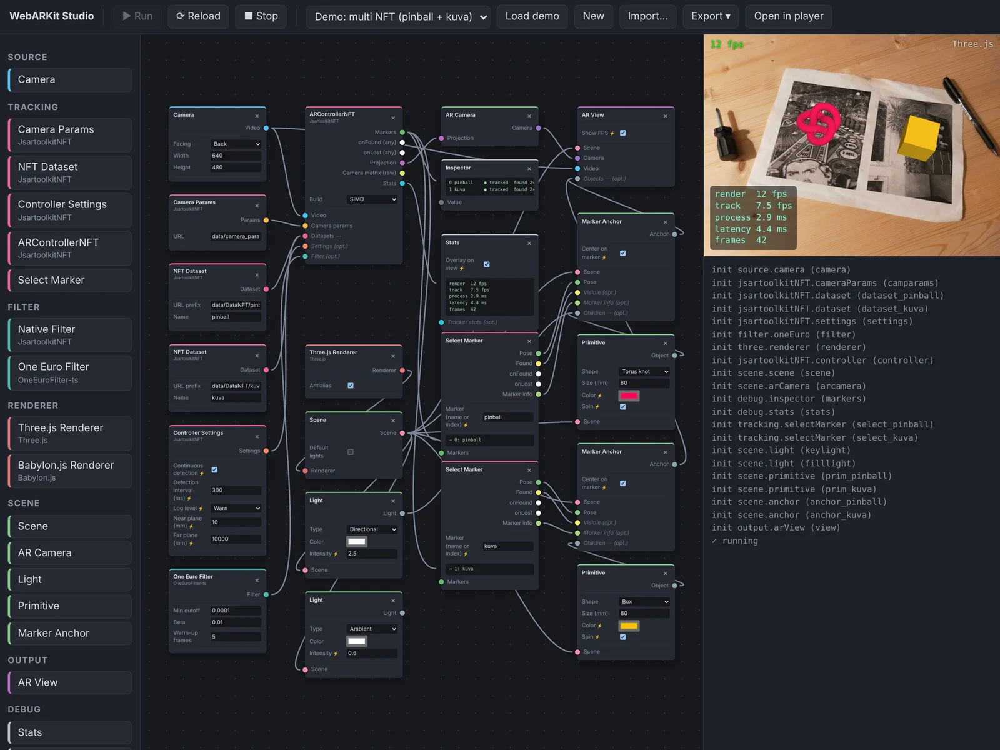

# WebARKit Studio

[](https://github.com/webarkit/webarkit-studio/actions/workflows/ci.yml)
[](https://www.typescriptlang.org/)
[](LICENSE)

<p align="center">
  
</p>

A node-based authoring tool for WebAR experiences. Users wire nodes
(camera → tracker → anchor → view) in a [Rete.js](https://retejs.org) editor; the
result is a plain JSON graph that a lightweight **player** executes with
[JsartoolkitNFT](https://github.com/webarkit/jsartoolkitNFT) and a 3D engine of
choice (Three.js or Babylon.js). The graph can be exported as a standalone app.

> **Status: prototype.** The architecture is being validated: the graph format
> may still change between versions (graphs since v0.1.0 upgrade when opened, see
> [Known issues](#known-issues--notes)). Nothing is published to npm.

## Quick start

```bash
npm install
npm run assets      # camera_para.dat, pinball + kuva NFT datasets, test photo
npm run dev         # studio at http://localhost:5173/, player at /player.html
```

Pick a demo (Three.js, Babylon.js, or multi NFT with pinball + kuva), click
**▶ Run** and point the camera at the printed markers. No camera? The
"pinball · image, no camera" demo tracks a photo of the marker (`source.image`;
`source.videoFile` plays a recorded video the same way; if you fetched the
assets before this demo existed, run `npm run assets` again for the photo).
"pinball · math and colour nodes" animates a cube with `math.time`, `math.sin` and
`math.vector3` wired into the Primitive's Position, and fades it with `color.rgba` on its Color;
"pinball · one formula" moves it the same way with a single `math.expression`
(`40 + 30 * sin(t * 180)`); "pinball · animated model" plays a model's clip on
`onFound` and pauses it on `onLost`. **⟳ Reload** restarts the preview (Stop + Run),
applying every param change; params marked ⚡ apply live without it.

Editing:

- **Add a node:** right-click the canvas and type to search (name, category or library), or filter the palette.
- **Undo / redo:** ↶ / ↷, or Ctrl+Z / Ctrl+Shift+Z (Ctrl+Y). Param edits are undone too.
- **Copy / paste / duplicate:** Ctrl+C / Ctrl+V (at the pointer, also between studio tabs) and Ctrl+D,
  or Duplicate in a node's right-click menu. Wires between the copied nodes are kept.
- **Arrange** lays the graph out left to right; the minimap (bottom right) moves the view.
- **Properties** (under the preview): every param of the selected node, including vectors and 4×4 matrices.

## Multi NFT

ARControllerNFT tracks every NFT Dataset connected to its `Datasets` input
(`loadNFTMarkers`). Its `markers` output is the tracking result of all of them;
a **Select Marker** node picks one, by the dataset's name or by index, and
gives its `pose`, `found`, `onFound`, `onLost` and `markerInfo` to an Anchor.
Pose filters and found / lost state are kept per marker. Select Marker reads a
tracker-agnostic `trackingResult`, so a future `webarkit.nftTracker` will plug
into the same nodes.

## Tests and benchmarks

```bash
npm test             # unit + integration (Vitest)
npm run test:e2e     # end-to-end (Playwright, Chromium); once: npx playwright install chromium
npm run bench        # benchmarks (tinybench); npm run bench -- runtime | tracker
npm run test:all     # typecheck + unit + integration + e2e
```

| Level | What | Where |
|---|---|---|
| Unit | graph validation and topological order, socket types, catalog consistency, runtime scheduler (order, live params, init failures, stop during init) with fake nodes, the mapping onto the tracker facade (filter, settings), the letterbox geometry, Select Marker, Inspector formatting, the trace format, trace diff and Trace Recorder buffering, export file selection and asset paths | `tests/unit` |
| Integration | the tracker session (`NftSession` on `createNFTTracker`, the code the controller runs over the facade's worker) against the **Node build** of JsartoolkitNFT on a photo holding both markers: marker sizes, two independent poses, found / lost once per marker, `lostTimeout` and AR2 settings, per-marker filtering, lens and projection, odd video sizes, per-dataset load errors; a **golden run** recorded with the former ARControllerNFT code (found and transitions exact; poses within the recorded range plus a margin, near the recorded mean, and near the recorded frame); **traces**: two recordings identical, a filter change reported, replay, live settings changes, the golden run's found / lost timing kept by the facade | `tests/integration` |
| End-to-end | the studio in Chromium with a fake camera: three demos tracking, onFound after loss, tracking a still image and a video file with no camera, multi NFT, live settings, Reload, init error on the failing node, incompatible wires rejected, a trace downloaded by the Trace Recorder; **exported apps** unzipped and run from a plain static server | `tests/e2e` |

The fake camera is a Y4M video generated in pure JS from the test photo
(`tests/e2e/fake-camera.ts`): the markers are visible 4 s, then hidden 2 s, in
a loop. It must be downscaled with a bicubic filter: a box filter softens the
fine detail enough for KPM to miss the kuva marker.

Benchmarks (Node 22, CI-class container; compare runs, not absolutes):

| `runtime.tick()`, no-op nodes | before | after (inputs resolved once) |
|---|---|---|
| 20 nodes / 19 edges | 8.7 µs | 1.3 µs |
| 80 nodes / 79 edges | 79.7 µs | 4.6 µs |
| 320 nodes / 319 edges | 789 µs | 18.8 µs |

| `NftSession.process()` (tracker facade), 320×240, Node build | mean |
|---|---|
| 1 marker, tracked (AR2) | 1.2 ms |
| 2 markers, tracked (AR2) | 2.3 ms |
| 2 datasets, nothing visible (KPM every frame) | 3.4 ms |

The tracker table was measured on a Windows desktop, not on the container.

### Tracking traces

A trace records what the tracker did, frame by frame, as JSON Lines: a header
(format version, jsartoolkit-nft version, frame size, settings, filter, targets,
where the frames came from), then one record per frame in the shape of the
facade's `FrameResult` (per-target found, pose, error; found / lost transitions;
time and process() duration), plus a record for each live settings change. The
format is defined in `src/runtime/trackers/trace.ts`.

```bash
npm run trace:record -- --out a.jsonl                     # Node: the golden run's frames, deterministic
npm run trace:record -- --out b.jsonl --filter oneEuro    # same frames, another filter (none | native | oneEuro)
npm run trace:record -- --out c.jsonl --replay a.jsonl    # replay a trace's frames and settings with this build
npm run trace:record -- --out g.jsonl --golden            # the golden run (ArtkSession, jsartoolkit-nft 1.14.0)
npm run trace:diff -- a.jsonl b.jsonl                     # pose deltas, found / lost timing, jitter; exit 1 above thresholds
```

In Node the frames are the golden run's (the test photo, then blank frames,
then the photo again, 33 ms apart, `Date.now` pinned), so two recordings of the
same build are identical and `trace:diff` reports *no difference*. In the
browser, wire a **Trace Recorder** (`debug.trace`) to the controller's `trace`
output and turn *Recording* on: the trace downloads when it is turned off, when
*Max frames* is reached or when the preview stops. Camera traces cannot be
replayed, and two of them only compare frame by frame if they have the same
frames; their jitter and timing are still useful.

`trace:diff` thresholds (`--translation-mm 1 --rotation-deg 0.5 --transition-ms 0
--found-frames 0 --jitter-mm 0.5 --jitter-deg 0.25` by default) and `--json` are
documented in `scripts/trace-diff.mjs`.

On devices, connect a **Stats** node to the controller's `stats` output and
enable *Overlay on view*: the exported app then shows render fps, tracking
fps, process() time and latency on the AR view.

CI (`.github/workflows/ci.yml`): typecheck, unit + integration, build, e2e on
every push / PR; benchmarks on pushes to `main`, in the job summary.

## Export

**Export ▾** in the toolbar:

| Format | Content |
|---|---|
| Graph (.json) | the node graph only; re-import it in the studio |
| Project (.zip) | the graph and its uploaded assets; open it with **Import…** |
| Standalone app (.zip) | player + graph + assets, runs on any static web server |
| Source code (.zip) | planned: readable code generated from the graph ([#64](https://github.com/webarkit/webarkit-studio/issues/64)) |

The standalone app is the prebuilt player (`npm run build:player`, run
automatically by `dev` and `build`) plus `graph.json` and the files its nodes
reference: params marked `asset` in the catalog (camera parameters, NFT
datasets). Only the chunks the graph uses are included: a Three.js graph
leaves out Babylon.js, a SIMD controller leaves out the standard build
(manifest written by `vite.player.config.ts`). Asset URLs inside the studio
keep their path; others are copied under `data/_ext/` and the graph is
rewritten. Uploaded assets are copied under `data/assets/<id>/`. glTF
models must be `.glb` or self-contained `.gltf` files: the export refuses a
`.gltf` that loads separate buffers or images.

```
pinball-nft-three-js/
  index.html  graph.json  README.txt
  assets/     player, three-adapter, jsartoolkit-nft plugin
  jsartoolkit-nft/1.16.0/  the tracker worker of the graph's build (SIMD here)
  data/       camera_para.dat, DataNFT/pinball.{iset,fset,fset3}
```

Serve it with `npx serve .` or `python3 -m http.server`. The host must answer
404 for missing files (see Known issues).
Camera access requires a secure context: `localhost` works; on a phone use
HTTPS or `adb reverse tcp:5173 tcp:5173`.

## MCP server

An [MCP](https://modelcontextprotocol.io) server lets an agent (Claude Code, Copilot in VS Code, Cursor,
Gemini CLI…) author, check, run and export graphs without the UI. `.mcp.json` declares it; to start it by hand:

```bash
npm run mcp:studio   # stdio, from the repository root
```

| Tool | What it does |
|---|---|
| `catalog_list` | node types with ports, params, defaults and live flags (core + plugins) |
| `graph_validate` | the studio's validation, as a list of problems |
| `graph_create` / `graph_edit` | build or change a graph with ops: add / remove nodes, connect, set params |
| `tracking_run` | the graph's tracker on JPEG images in Node: per-frame poses and found / lost, as trace records |
| `trackability_check` | rates an NFT dataset from its `.fset3` and `.fset`: the report of `npm run trackability -- <dataset> --json` |
| `export_bundle` | the standalone app `.zip`, from the studio build (`npm run build`, in `dist/`) |

### Try it

1. Once: `npm install`, `npm run assets` (camera parameters, datasets and the test photo
   `tests/fixtures/pinball-demo.jpg`), and `npm run build` if you want `export_bundle` (it exports from `dist/`).
2. Open your MCP client in the repository root. Claude Code picks up `.mcp.json` and asks to
   approve `webarkit-studio`; `/mcp` then shows it connected with its seven tools. Other clients:
   add a stdio server running `node --import tsx src/mcp/main.ts` from the repository root.
3. Ask, for example:

   > Using catalog_list, build a tracking graph for the pinball dataset, validate it, run it with
   > tracking_run on tests/fixtures/pinball-demo.jpg for 10 frames then 12 blank frames, and tell me
   > in which frames the marker is found and lost.

   The marker is found on the photo frames and lost about six blank frames later: the tracker's
   `lostTimeout` (200 ms) at 33 ms per frame. Then, for instance, "export
   public/graphs/pinball-three.json with export_bundle to out/app.zip", and serve the unzipped
   folder with `npx serve`.

Graphs are passed inline or as a path; the tools write nothing except `export_bundle`'s zip.
The tests (`tests/unit/mcp-*.test.ts`, `tests/integration/mcp-*.test.ts`, and `tests/e2e/mcp-export.spec.ts` on the real build) cover every tool, the
stdio transport and this scenario. See `src/mcp/AGENTS.md`.

## Assets

**Upload…** in the *assets* panel (under the palette) adds files to the
project: images and videos, NFT datasets (select the `.iset`, `.fset` and
`.fset3` files together) and glTF models (`.glb`, or a self-contained
`.gltf`). They are saved in the browser (IndexedDB) next to the autosaved
graph, and **Export → Project (.zip)** carries them to another browser.

A param marked `asset` takes a URL or an upload of its kind: its field
suggests the matching uploads, as `asset://<id>/<name>` references. The graph
format is unchanged, but a graph with such references needs the project's
assets (and a studio or player from this version on) to run. While the graph
runs, uploads are served as `blob:` URLs; an uploaded NFT dataset is served to
the tracker's worker under a virtual `https://assets.webarkit.invalid/` prefix
(with its files' `blob:` URLs in the query string), and the prefix appears in
its tracking traces.

glTF Model (`scene.gltf`) stands models up on the marker with their front
(glTF +Z) facing the marker's bottom edge (marker −Y); turn them with
the Z of *Rotation*. *Autoplay* plays the model's first clip in a loop, on
both renderers, and its status lists the clips. Compressed models (Draco,
KTX2, meshopt) are not supported on Three.js; Babylon.js decodes them with
decoders it downloads from its CDN, so prefer uncompressed models.

Before you upload a dataset made from a new image, check that it will track:

```bash
npm run trackability -- path/to/marker        # its .fset3 and .fset: detection points, coverage,
                                              # repetition, tracking points; exit 1 when poor
npm run example:marker                        # a generated marker image in generated/
npm run example:project -- generated/scribbles   # its dataset + a glTF model + a graph, for Import…
```

[Creative tools](docs/agents/creative-tools.md) sets up Blender, ComfyUI and
Krita as MCP servers for markers and models, and walks through the example.

## Architecture

```
            ┌──────────────── GraphDocument (JSON) ────────────────┐
            │  nodes: [{id, type, params, position}]               │
            │  edges: [{from:{node,port}, to:{node,port}}]          │
            └───────────────▲───────────────────────┬──────────────┘
          load / toDocument │                       │ loadGraphDocument + topologicalOrder
┌───────────────────────────┴─────┐   ┌─────────────▼──────────────────────────┐
│ Editor (Rete.js + lit-html)     │   │ Runtime / player (no Rete)             │
│ - StudioNode = view of catalog  │   │ - NODE_REGISTRY: type → factory        │
│ - typed sockets, validation     │   │ - init() once, update() every frame    │
└───────────────┬─────────────────┘   └─────────────┬──────────────────────────┘
                └──────── Node catalog (ports + params, no heavy deps) ┘
```

Key decisions:

1. **The JSON graph is the source of truth.** The editor is a view over it, the
   player only reads it. The player bundle contains no Rete code.
2. **Catalog and implementation are split.** `src/nodes/catalog.ts` describes
   ports and parameters (pure data, shared by editor and runtime).
   `src/runtime/registry.ts` maps each type to its implementation.
3. **The runtime has its own tiny scheduler** (topological order, `init` then
   per-frame `update`) instead of `rete-engine`: AR needs a frame loop with
   async setup and stateful nodes, which the Rete dataflow engine does not model,
   and it would tie the player to Rete.
4. **Tracking runs in a Web Worker**, one per controller node, as JsartoolkitNFT
   recommends: the facade's own (`createNFTTrackerWorker`). Frame preparation
   follows the upstream `threejs_worker_ES6.js` example; the facade's
   `projectionFor()` rescales the projection.
5. **Rendering with lit-html.** Rete maintains renderers only for React, Vue,
   Angular and Svelte; `src/editor/lit-render-plugin.ts` (~200 lines)
   implements the same render contract with lit-html.
6. **Renderer → Scene → objects.** A renderer node (`three.renderer`,
   `babylon.renderer`) is only the engine and its canvas. A **Scene** node,
   connected to it, is where Primitive, Light and Marker Anchor create their
   objects (Babylon.js requires a scene at creation time). AR View draws a
   scene through an **AR Camera** fed by the tracker projection. Switching
   engine = rewiring one node. Each engine is loaded with a dynamic import.
   Creation context (`scene` input) and hierarchy (`Anchor.children`,
   `AR View.objects`) are separate wires, which keeps the graph acyclic.
7. **Slots on the controller.** Optional `filter` and `settings` inputs.
   Their nodes output serialisable values that the controller forwards to its
   tracker; an empty slot means library defaults / raw poses.
8. **Live params.** Params marked ⚡ (`live` in the catalog) reach the running
   graph without restarting; the others apply on the next Run. A live change on
   the Settings node becomes a new settings value, the controller sees it and
   calls its tracker's `configure()`.
9. **Events are values.** An event output carries `{count, time, data}` and a
   new object each time it fires, though a new object is not always a firing
   ([Events](docs/plugins.md#events) says how to detect one). `onFound` /
   `onLost` come from the tracker's per-frame `transitions` (`found` on the
   first tracked frame, `lost` once after `lostTimeout`, 200 ms by default);
   a marker's `found` output is the raw per-frame tracking.
10. **Trackers are plugins.** A plugin (#12) adds nodes, sockets, factories
    and export files through a typed manifest (`StudioPlugin`,
    `src/plugin-api`), without changes to the studio. jsartoolkitNFT is one
    (`plugins/jsartoolkit-nft/`), listed in `webarkit-studio.config.ts`: the
    studio loads every plugin, the player only those its graph lists in
    `plugins`. See [Writing a plugin](docs/plugins.md).

### Naming

Node types are `<namespace>.<name>`, with the wrapped library as namespace:
`jsartoolkitNFT.controller`, `three.renderer`, `babylon.renderer`. Built-ins
use functional namespaces (`scene.*`, `filter.*`, `tracking.*`, `debug.*`,
`output.*`, `source.*`, `math.*`, `color.*`, `logic.*`, `action.*`).
**`webarkit.*` is reserved** for the webarkit/webarkit packages, so a future
`webarkit.nftTracker` (@webarkit/nft-tracker) cannot be confused with the
JsartoolkitNFT controller. Library-specific data has its own socket type,
defined by its plugin and prefixed with the plugin id
(`jsartoolkitNFT.cameraParams`, `jsartoolkitNFT.dataset`), so it cannot be
wired into another library's node.

### Renderer conventions

Every adapter follows the same conventions: millimetres, marker on the XY
plane with +Z out of it, column-major 4x4 matrices, camera at the origin
looking down −Z with the AR Camera projection. Babylon.js runs in
right-handed mode so ARToolKit poses apply unchanged. Objects remember the
scene that created them: wiring an object into a node of another scene (or
engine) fails at init with a clear error.

### Lights and spaces

The scene root is **camera space** (the camera is the origin; marker poses
are relative to it). A Light left unconnected, or wired to AR View, stays
there and lights the scene from the viewer. Wired to a Marker Anchor's
`children`, it follows the marker and lights from above it (+Z of the
marker). The adapters hide engine differences: Three.js derives a hemisphere
light's direction from its world position, and Babylon.js ignores a
hemispheric light's parent, so both are re-oriented from the parent each
frame. Intensities use the Three.js scale; Babylon scales them down.

### Execution model

- `init(inputs)` runs once per node in topological order; inputs are the
  init-time outputs of upstream nodes (camera opened, WASM loaded, dataset
  parsed…).
- `update(inputs, frame)` runs every `requestAnimationFrame`, in the same order.
  Nodes return only the ports that changed.
- Inputs declared `multiple` receive an array (e.g. `Anchor.children`,
  `AR View.objects`).
- `onParamChange(key, value)` runs when a live param is edited during the
  preview; it may return changed outputs.
- Nodes can report text to the studio (`ctx.report`), shown inside the node:
  the Inspector uses it, and init errors are shown on the failing node.

## Project layout

```
src/
  core/        graph.ts (format, validation, topo sort), sockets.ts (type system), plugins.ts (manifest checks)
  nodes/       catalog.ts — core node definitions (metadata only)
  plugin-api/  the types a plugin is written against (@webarkit/studio-plugin-api)
  plugins/     host.ts — installs plugins into the catalog, sockets and registry
  editor/      Rete setup, StudioNode, lit-html render plugin (nodes, context menu, minimap);
               node search, undo of param edits, clipboard, layered auto-arrange
  runtime/     GraphRuntime, registry, node implementations
    trackers/  trace.ts (trace format)
    filters/   the pose filter slot's config (applied by the tracker)
    renderers/ RendererAdapter + Three.js / Babylon.js adapters
  app/         studio.ts (editor + live preview), player.ts (standalone)
  export/      exporters (graph JSON, standalone app bundle)
plugins/
  jsartoolkit-nft/  the jsartoolkitNFT plugin: catalog, factories, NftSession (the graph mapped onto
                    the tracker facade, shared by the browser and the tests), the tracker's
                    worker files (served by its Vite plugin, vite.ts) and virtual-fetch.ts
packages/
  studio-plugin-api/  the plugin API's types as a package, generated from src/plugin-api (not published)
webarkit-studio.config.ts  the plugins this build loads
public/graphs/ pinball-three.json, pinball-babylon.json, multi-three.json
scripts/       fetch-assets.mjs, trace-record.mjs / trace-diff.mjs (tracking traces), check-agent-docs.mjs
tests/         unit/, integration/, e2e/, bench/, helpers/
vite.player.config.ts   standalone player build (→ public/__player, + manifest)
```

Planned split once the format stabilises (npm workspaces):
`@webarkit/studio-graph` (core + catalog), `@webarkit/studio-runtime`,
`@webarkit/studio-editor`, `apps/studio`.

## Nodes

| Type | Status | Inputs → Outputs |
|---|---|---|
| `source.camera` | ✅ | → video |
| `source.image` | ✅ | → video (a still image: testing without a camera) |
| `source.videoFile` | ✅ ⚡ | → video (a video file, loop: testing without a camera) |
| `jsartoolkitNFT.cameraParams` | ✅ | → camera params |
| `jsartoolkitNFT.dataset` | ✅ | → NFT dataset |
| `jsartoolkitNFT.settings` | ✅ ⚡ | → settings (continuous detection, detection interval, log level, near / far, lost after, AR2 tracking parameters) |
| `jsartoolkitNFT.controller` | ✅ | video, cameraParams, datasets[], settings?, filter? → markers, onFound, onLost, projection, cameraMatrix, stats, trace |
| `tracking.selectMarker` | ✅ ⚡ | markers → pose, found, onFound, onLost, markerInfo |
| `jsartoolkitNFT.nativeFilter` | ✅ | → poseFilter (the tracker's `'native'` filter) |
| `filter.oneEuro` | ✅ | → poseFilter (One Euro, @webarkit/oneeurofilter-ts inside the tracker) |
| `three.renderer` | ✅ | → renderer |
| `babylon.renderer` | ✅ | → renderer |
| `scene.scene` | ✅ | renderer → scene |
| `scene.arCamera` | ✅ | projection → camera |
| `scene.light` | ✅ ⚡ | scene, color? → sceneObject (directional / hemisphere / ambient) |
| `scene.primitive` | ✅ ⚡ | scene, position?, color? → sceneObject (box, sphere, torus knot; position, rotation, spin; alpha below 1 is transparent) |
| `scene.gltf` | ✅ ⚡ | scene → sceneObject (glTF / GLB model, URL or upload; scale, rotation, position; autoplay of its first clip) |
| `scene.anchor` | ✅ | scene, pose, found?, markerInfo?, children[]? → sceneObject |
| `output.arView` | ✅ | scene, camera, video, objects[]? → |
| `math.expression` | ✅ ⚡ | a?, b?, c?, d?, t? → number (a formula, e.g. `40 + 30 * sin(t * 180)`: `+ - * / % ^`, `!`, comparisons, `&& \|\|`, `? :`, functions in degrees; a–d override their params, t is its own clock unless wired; no `eval`) |
| `math.number` | ✅ ⚡ | → number |
| `math.vector3` | ✅ ⚡ | x?, y?, z? → vector3 (connected inputs override the params) |
| `math.splitVector3` | ✅ | vector3 → x, y, z |
| `math.add` / `math.multiply` | ✅ ⚡ | a?, b? → number |
| `math.addVector3` / `math.scaleVector3` | ✅ ⚡ | a?, b? → vector3 / vector?, factor? → vector3 |
| `math.sin` | ✅ ⚡ | x? (degrees) → offset + amplitude × sin(x) |
| `math.time` | ✅ ⚡ | → seconds since start (× speed) |
| `color.rgba` | ✅ ⚡ | r?, g?, b?, a? → color (`[r, g, b, a]`, 0–1, sRGB) |
| `color.split` | ✅ | color → r, g, b, a |
| `logic.and` / `logic.or` | ✅ | a, b (boolean) → value |
| `logic.not` | ✅ | value → value |
| `logic.toggle` | ✅ | trigger, reset? (event) → value (flips on trigger; *initial*) |
| `logic.timer` | ✅ ⚡ | start, cancel? (event), duration? → onDone, running (*duration* in s, *repeat*) |
| `logic.compare` | ✅ ⚡ | a?, b? → value (`==`, `!=`, `<`, `<=`, `>`, `>=`, with a tolerance for `==` and `!=`) |
| `logic.edge` | ✅ | value → onRise, onFall |
| `logic.branch` | ✅ | trigger, condition? → onTrue, onFalse (if / else for events) |
| `logic.switch` | ✅ ⚡ | trigger, index? → case0–case3, onDefault |
| `action.playAnimation` | ✅ ⚡ | target, play?, pause?, stop? (events) → (a clip of a glTF model; *loop*, *speed*) |
| `action.setVisible` | ✅ | target, show?, hide?, toggle? (events) → (a model or a primitive) |
| `action.playSound` | ✅ ⚡ | play?, stop? (events) → (a sound file; *volume*, *loop*) |
| `action.openUrl` | ✅ ⚡ | show?, hide? (events) → (a link on the AR view; http and https only; *label*) |
| `debug.inspector` | ✅ | any → (value shown in the node) |
| `debug.stats` | ✅ ⚡ | stats? → (fps, process ms, latency; optional overlay on the AR view) |
| `debug.trace` | ✅ ⚡ | trace → (records while *Recording* is on, downloads a JSONL trace) |
| `jsartoolkitNFT.datasetZft` | planned | → NFT dataset (`.zft`) |
| `jsartoolkitNFT.controller` threaded build (`/td`) | planned | needs COOP/COEP headers |
| `webarkit.cvBackend` | planned | → cvBackend (jsfeatNext / PureCV, @webarkit/cv-backend-spec) |
| `webarkit.target` | planned | → wnftTarget (`.wnft`) |
| `webarkit.nftTracker` | planned | video, cvBackend, target, filter? → pose, found, … |
| `filter.ema`, `filter.kalman` | planned | → poseFilter |
| `scene.text`, `scene.video` | planned | scene → sceneObject |
| AR Camera near / far override | planned | renderer-side override, for trackers that do not own their planes |
| `playcanvas.renderer`, `aframe.renderer` | idea | → renderer |
| `logic.and` / `not` / `timer` / `toggle` | planned | boolean / event |
| `action.playAnimation` / `playSound` / `openUrl` | planned | event → |
| `debug.featurePoints` | planned | → overlay |

`?` = optional input, `[]` = accepts several connections, ⚡ = live params.
Required inputs are checked before running.

### Tracker facade API coverage

The controller node runs the jsartoolkitNFT tracker facade in the facade's own
worker (`createNFTTrackerWorker` from `@webarkit/jsartoolkit-nft/client`,
≥ 1.16.0).

| Tracker facade | In the graph |
|---|---|
| `createNFTTrackerWorker({ width, height, cameraParam }, { build, workerBase, signal })`, `process(frame, timestampMs)` | inside the controller node (one tracker, in its worker); `build` is the controller's *Build*, the start times out after 30 s |
| `process()` → `{ skipped: true }` | ignored: the controller sends a frame only when the previous one is done |
| `addNFTTargets(sources)` → `TargetLoad[]` | the Datasets input, in order; a failed dataset is reported on the node, one line per dataset |
| `configure({ continuousDetection, detectionInterval, logLevel, near, far, lostTimeout, ar2 })` | Controller Settings (live) |
| `filter: 'none' \| 'native' \| { type: 'oneEuro' }` | the `filter` slot: nothing, Native Filter, One Euro Filter |
| `TargetInfo` (`widthPx`, `heightPx`, `dpi`, `widthMm`, `heightMm`) | `markerInfo` (via Select Marker) |
| `cameraMatrix` | `cameraMatrix` output (raw), rebuilt live when near / far change |
| `projectionFor(viewport, geometry)` | `projection` (letterbox undone), rebuilt with the lens |
| `FrameResult.targets` / `transitions` | `markers` (pose, found, onFound, onLost per marker), controller `onFound` / `onLost` for any marker |
| `addNFTTargets` `origin: 'center'` | not exposed: Marker Anchor's *center* does it in the scene |

## Known issues / notes

- Hosting must return **404** for missing files: JsartoolkitNFT's
  tracker probes `<marker>.zft` before the other files and treats any HTTP 200
  (such as an SPA `index.html` fallback) as a compressed dataset (upstream #676). The
  Vite config sets `appType: 'mpa'` for this reason.
- Each tracker worker embeds its WASM (~716 kB); the page loads only the light
  client (a few kB, in the plugin's chunk) and the worker of the selected build
  (SIMD or standard). The worker files are served unchanged from
  `jsartoolkit-nft/<version>/` next to the page, outside the Vite pipeline (the plugin's
  `vite.ts`), and exported apps get only their build's. The threaded build
  (`td`) and `build: 'auto'` are not offered: they need COOP / COEP headers.
- Lazy chunks: Three.js adapter ~530 kB, Babylon.js adapter ~790 kB (deep
  imports from `@babylonjs/core`; the barrel import would be ~5 MB).
- The tracker's One Euro filter (`@webarkit/oneeurofilter-ts`) fixes `dCutOff`
  at 0.001, so the One Euro node exposes min cutoff, beta and warm-up only. The
  warm-up poses pass through unfiltered but are fed to the filter.
- Graph format is `webarkit-studio/graph` v5. A v4 graph upgrades when it is opened,
  and the file itself is not touched. v2 and v3, prototype formats, are refused, and
  a newer document asks for a newer studio. An unfinished autosave, with a required
  input not connected, reopens: **Run** and the standalone app export report what it
  lacks. A file with such a graph is still refused on **Import…**. One that
  cannot be opened is kept in localStorage as
  `webarkit-studio:autosave-set-aside`, and the demo opens. Graphs
  saved by the prototype under its former name (`webar-studio/graph`) still load,
  and so does its last autosave.
- JsartoolkitNFT ≥ 1.16.0 is required (the tracker facade and its light
  client). Since 1.16.0 the One Euro filter keeps poses rigid, so filtered poses
  differ slightly from 1.15.0. Its lens follows
  the planes from the start: the near 0.0001 init lens of 1.14.0 is gone.
- The processing frame has integer sizes (`letterbox()`, which calls
  `@webarkit/camera-view`): the facade rejects a frame whose size differs from
  the tracker's.
- Near / far are in marker units (mm). Controller Settings defaults to
  10 mm / 10 m; without a settings node the library planes (0.1 / 1000) are used,
  so content farther than 1 m from the camera is clipped.
- The data-oriented API proposal,
  [jsartoolkitNFT#720](https://github.com/webarkit/jsartoolkitNFT/issues/720)
  (`docs/proposals/`), is still open upstream; 1.15.0 ships its tracker facade,
  1.16.0 the light client for its worker.

## Roadmap

The source of truth for the roadmap is
[#1](https://github.com/webarkit/webarkit-studio/issues/1). This list follows it.

**Phase 1 — Foundation (this prototype)**
- [x] Graph format v1 + validation
- [x] Rete editor with typed sockets and a lit-html renderer
- [x] Runtime + standalone player
- [x] JsartoolkitNFT controller node (worker, SIMD/standard)
- [x] Provider-namespaced node types, `webarkit.*` reserved
- [x] Renderer abstraction: Three.js + Babylon.js
- [x] Pose filter slot: One Euro, ARToolKit native
- [x] Renderer / Scene / AR Camera split, Light node
- [x] Controller settings slot with live `configure`
- [x] `markerInfo` / `cameraMatrix` outputs, Inspector node
- [x] `onFound` / `onLost` events
- [x] Lights in camera or marker space
- [x] Reload button
- [x] Export: standalone app bundle (only the engines and builds the graph uses)
- [x] Multi NFT: several datasets per controller, Select Marker, per-marker filters and events
- [x] Tests (unit, integration with the Node build, e2e with a fake camera), benchmarks, CI
- [x] Stats node; runtime input plan (7–42× faster per frame)
- [x] jsartoolkit-nft 1.14.0: live near / far via `recalculateCameraLens()`
- [x] jsartoolkit-nft 1.15.0: the tracker facade (`createNFTTracker`) replaces the hand-written tracking code (#5)

**Phase 2 — Authoring**
- [x] Inspector panel for complex params (`vector3`, `matrix4` param kinds)
- [x] Undo / redo (`rete-history-plugin`), including param edits
- [x] Context menu / search to add nodes, minimap, auto-arrange (a layered layout instead of elkjs), copy / paste
- [x] Asset manager: upload images and datasets, glTF models
- [x] First math nodes and a Primitive position driven by an input (#25)
- [x] Plugin API (#12): typed manifest, graph format v5 `plugins`, jsartoolkitNFT moved onto it
- [x] jsartoolkit-nft 1.16.0: the facade's own worker (`createNFTTrackerWorker`, light client) replaces ours (#14)
- [x] MCP server (#8): catalog, graph editing and validation, tracking on images in Node, app export

**Phase 3 — Logic and publishing (v0.3.0, [#3](https://github.com/webarkit/webarkit-studio/issues/3), which has the full list)**
- [ ] glTF animations on both renderers ([#58](https://github.com/webarkit/webarkit-studio/issues/58))
- [ ] Logic nodes and the event model ([#59](https://github.com/webarkit/webarkit-studio/issues/59))
- [ ] Action nodes triggered by events ([#60](https://github.com/webarkit/webarkit-studio/issues/60))
- [ ] Math nodes: numbers, vectors, matrices, functions, renderer-independent ([#24](https://github.com/webarkit/webarkit-studio/issues/24))
- [ ] Script nodes: `script.lite` ([#35](https://github.com/webarkit/webarkit-studio/issues/35)), `three.script` ([#36](https://github.com/webarkit/webarkit-studio/issues/36)), `three.renderScript` ([#37](https://github.com/webarkit/webarkit-studio/issues/37))
- [ ] Graph format migrations: older `version`s upgrade on load ([#61](https://github.com/webarkit/webarkit-studio/issues/61))
- [ ] Deploy: an export with a GitHub Actions workflow, which you push to your own repository for GitHub Pages; the studio holds no credential ([#62](https://github.com/webarkit/webarkit-studio/issues/62))
- [ ] Threaded JsartoolkitNFT build, and cross-origin isolation in the export ([#63](https://github.com/webarkit/webarkit-studio/issues/63))
- [ ] Export: readable source code (Three.js first) ([#64](https://github.com/webarkit/webarkit-studio/issues/64))

**Phase 4 — Scene and editor (v0.4.0)**
- [ ] Node selection and macros in the editor
- [ ] Scene nodes on both engines (geometry, mesh, materials, lights, shadows, environment), with a conformance suite

**Phase 5 — Authoring tools and interaction (v0.5.0)**
- [ ] Near / far on AR Camera, a preview camera, scene helpers, fog, custom geometry
- [ ] NFT dataset generation from an uploaded image
- [ ] Touch and mouse interaction with meshes and markers

**Unscheduled**
- [ ] WebARKit integration ([#4](https://github.com/webarkit/webarkit-studio/issues/4)): no phase and no version; it starts when webarkit/webarkit publishes `@webarkit/nft-tracker`
- [ ] Not planned for a release yet: artoolkit5-ts as the first external plugin ([#31](https://github.com/webarkit/webarkit-studio/issues/31))
- [ ] Not planned for a release yet: loading plugins from a URL ([#32](https://github.com/webarkit/webarkit-studio/issues/32))

## History

WebARKit Studio is a rewrite, not a continuation of the existing code. It
replaces [WebAR-Studio](https://github.com/webarkit/WebAR-Studio), a fork of
[arStudio](https://github.com/augmentmy-world/arStudio) built on webglstudio.js,
which stays available for reference. None of its code is reused here.

It is a separate project from [AR.js Studio](https://github.com/AR-js-org/studio),
which creates AR.js marker-based apps without a node editor.

## Contributing

See [CONTRIBUTING.md](CONTRIBUTING.md). Pull requests target `dev`; `master` is
for releases.

## License

[LGPL-3.0-or-later](LICENSE). Copyright 2026 WebARKit.
